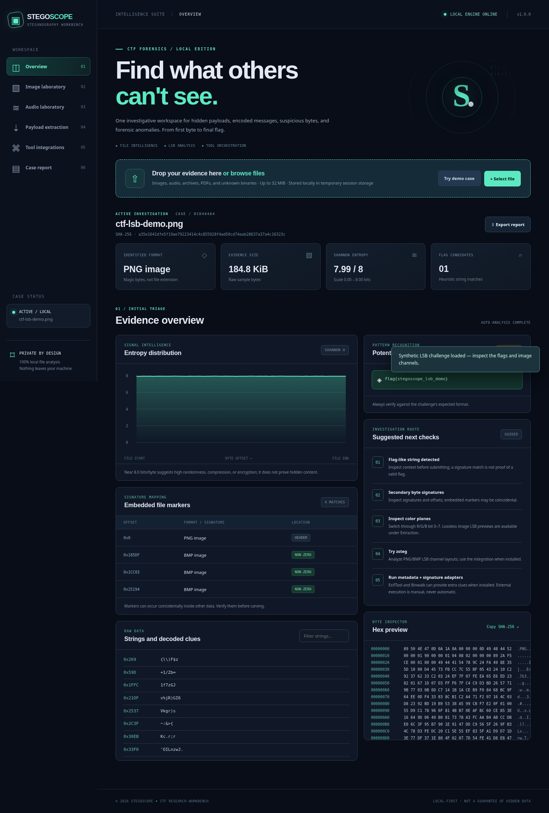

# STEGOSCOPE — Local CTF Steganography Workbench

> **Find what others can't see.** A privacy-first, browser-based forensic workbench for inspecting CTF files on **your own Mac** without uploading them to a cloud service.



**Status:** Functional v1.0 starter, with tested built-in analysis and optional adapters. It does **not** claim to solve every steganography technique or include every external tool in its ZIP.

## 🚀 Run on macOS (Python 3.11+)

1. Unzip `STEGOSCOPE.zip` in Downloads.
2. Open Terminal and run:

```bash
cd ~/Downloads/STEGOSCOPE
chmod +x run.sh
./run.sh
```

3. Open **http://127.0.0.1:8787** in your browser.
4. Select **Try demo case**. The built-in sample is a real PNG with `flag{stegoscope_lsb_demo}` embedded in the **red channel LSB**. Find it under **Overview**, **Image laboratory**, or extract the `R / 1-bit / MSB` byte stream.

`run.sh` creates `.venv`, installs Python requirements into it, and starts a localhost-only server. You do **not** need React, Node, a paid AI model, or Docker to start.

If you prefer manual commands:

```bash
cd ~/Downloads/STEGOSCOPE
python3 -m venv .venv
source .venv/bin/activate
pip install -r requirements.txt
python -m uvicorn app.main:app --host 127.0.0.1 --port 8787
```

To stop: `Control + C` in Terminal. Evidence and recovered files live in a temporary folder for the duration of the running local Python process, not in a cloud service. Closing the browser tab alone does not stop the server.

## Features that work without external command-line tools

| Area | Current functionality |
| --- | --- |
| Quick triage | Magic byte format identification, SHA-256/MD5 identification hashes, file size, whole-file and block entropy |
| Signature analysis | Embedded signature/offset scan, byte-accurate manual carving, PNG trailer and JPEG trailing byte checks |
| Strings | Printable strings with offsets, CTF flag-pattern suggestions, base64 / hex textual clues |
| Text stego | Heuristic zero-width Unicode and trailing whitespace inspection |
| Images | Normalized preview, RGB bit planes 0–7, LSB ratios, PNG/BMP LSB scan, configurable LSB byte export |
| PNG analysis | Chunk offset/length/CRC verification and textual chunk previews |
| WAV analysis | PCM metadata, FFT spectrogram, LSB byte export, tentative printable strings/flags |
| ZIP | Container listing (when the file itself is a ZIP) without unpacking it |
| Evidence handling | Local browser dashboard, file size cap (32 MiB), bounded outputs, JSON case reports |

**Important:** The scanner reports **indicators**, not confirmed payloads. JPEG compression can destroy simple pixel LSB steganography, highly random bytes may simply be compressed/encrypted, and short signature patterns may produce coincidences.

## Optional integrations

The interface automatically marks these tools as **Installed** or **Missing** by inspecting your local executable search path. They're optional and not redistributed in this project.

| Adapter | Action | Scope |
| --- | --- | --- |
| **ExifTool** | Metadata read | Broad file support |
| **Binwalk v3** | Signature scan (read-only) | General binary/firmware |
| **zsteg** | Stego layout detection | PNG / BMP |
| **Steghide** | Info probe and passphrase extraction | JPEG / BMP / WAV |
| **Stegseek** | Bounded user-provided wordlist recovery | Steghide-supported images/audio |
| **FFprobe** | Stream/container details | Audio/video |
| **zbarimg** | Barcode and QR decoding | Images |
| **Tesseract** | OCR for visible text | Images |

You can optionally run `./install_optional_macos.sh` for prompted installation, or install the tools yourself.

On a recent supported macOS with Homebrew:

```bash
brew install binwalk exiftool ffmpeg zbar tesseract
```

For **zsteg**, install Ruby (if needed), then `gem install zsteg`. If your Ruby installation disallows system gems, use a Ruby version manager or your preferred Ruby environment. The detected CLI must be available on the Terminal's `PATH`.

For **Steghide**, the published MacPorts package is available after installing MacPorts:

```bash
sudo port install steghide
```

**Stegseek** may require building from the [official source](https://github.com/RickdeJager/stegseek) or using a compatible build for your architecture. This project does not automatically install it or claim a universal macOS installer. See upstream guidance before installing a third-party binary.

Useful official resources: [Binwalk](https://github.com/ReFirmLabs/binwalk), [zsteg](https://github.com/zed-0xff/zsteg), [Steghide](https://steghide.sourceforge.net/), [Stegseek](https://github.com/RickdeJager/stegseek), [ExifTool](https://exiftool.org/), [MacPorts Steghide](https://ports.macports.org/port/steghide/).

### Run all available read-only adapters

After uploading a file, open **Tool integrations → Run all read-only scans**. This runs compatible installed adapters, in sequence, with timeouts; it does not extract or run embedded executables. **Steghide extraction and Stegseek recovery require your explicit action** in Payload extraction.

## What is not implemented yet

This is a usable v1 workbench, not an all-in-one replacement for every specialist program. Current gaps include:

- Full automated, recursive Binwalk `-Me` extraction (deliberately not enabled for safety); use an isolated container/workstation for potentially hostile recursive extraction.
- OutGuess, OpenPuff, OpenStego, SilentEye, StegSolve and Sonic Visualiser wrappers. GUI tools and proprietary binaries are **not** embedded or silently simulated.
- Video frame extraction, audio codecs beyond PCM WAV spectrogram inspection, robust PDF object tree inspection, and higher-level cryptanalysis/OCR reasoning chains.
- A connected LLM or automated flag validation service. Guided steps currently use explainable heuristic rules, not an AI model.
- Multi-user/public deployment, server-side accounts, collaboration, malware sandboxing, or hardened untrusted-sample processing.

A sensible v2 roadmap: image channel transform presets; GIF animation/frame differencing; optional ffmpeg-converted audio and video frames in a restricted worker; PDF object parser; curated encodings chains; CTF challenge notebook; safe containerized extractors; and an optional local Ollama model for evidence **interpretation** (not guaranteed solutions).

## Safety and privacy

- Bind the server to **127.0.0.1 only**. This app has no authentication, and **must not be exposed to the public internet**.
- Uploads use in-memory session records and temporary local files. Up to eight cases are retained per running process; the oldest is evicted on a new upload. The temporary directory is removed on normal process shutdown. No remote requests or analytics are built into the UI.
- Treat challenge files as **untrusted**. Decoders and installed analysis binaries may themselves have vulnerabilities; use a disposable isolated environment for suspicious non-CTF files.
- External CLIs execute **only on explicit button clicks**, with fixed argument lists and no shell interpolation. Tool outputs are truncated and executions have timeouts. These are safeguards, **not a security sandbox**.
- Steghide passphrases are passed to its **local subprocess argument list**, which may be visible to local process-monitoring tools; do not use personal/account passwords. The interface does not add them to the case JSON. Supplied Stegseek wordlists are stored locally in temporary files until shutdown.
- Do not execute recovered binaries blindly. Verify recovered file hashes and interpret results as clues.
- Use only files you own or are permitted to analyze.

## Project structure

```text
STEGOSCOPE/
├── app/
│   ├── __init__.py
│   ├── engine.py           # Native triage, image/audio/text analysis
│   └── main.py             # FastAPI routes and allowlisted CLI adapters
├── static/
│   ├── index.html          # Responsive dashboard
│   ├── style.css           # Dark UI, no CDNs
│   └── app.js              # Browser controls and visualizations
├── samples/
│   └── lsb-demo.png        # Synthetic sample, built into demo button too
├── docs/dashboard.png      # Dashboard preview
├── tests/
│   ├── test_engine.py
│   └── test_api.py
├── requirements.txt
├── requirements-dev.txt
├── pytest.ini
├── run.sh
├── install_optional_macos.sh # Opt-in Homebrew/RubyGems installation
├── LICENSE
└── README.md
```

## Test locally

```bash
source .venv/bin/activate
pip install -r requirements-dev.txt
python -m pytest -q
```

The test suite covers synthetic PNG LSB recovery, PNG CRC/trailer detection, WAV LSB + spectrogram, decoding/entropy checks, download/carve/report endpoints, invalid parameters, and app health. Web UI was also exercised in a Chromium harness for demo navigation, image plane output, and report rendering. Optional third-party binaries are not covered by the automated tests; actual behavior depends on your installed version.

## License

MIT for this project's original code. External utilities remain separately licensed by their authors.
